## ▌SOBRE MÍ

> `SYSTEM://PERFIL` · estado: **en línea** · ubicación: **Colombia 🇨🇴**

Soy desarrollador en formación con enfoque en calidad de software. Construyo aplicaciones web y APIs con JavaScript, Node.js y NestJS, y automatizo pruebas y validación de datos con Python.
Me apasiona escribir código limpio, probar lo que construyo, el análisis de datos y el manejo de SQL, y seguir aprendiendo cada día.

## ▌MÓDULOS INSTALADOS

  
  
  
  
  
  
  
  
  
  

## ▌MISIONES ACTIVAS

- **[riwi-qa-spark](https://github.com/tuusuario/riwi-qa-spark)**: pipeline de validación de transacciones con PySpark.

## ▌REGISTRO DE ACTIVIDAD

  

## ▌ESTABLECER CONEXIÓN

  
  

