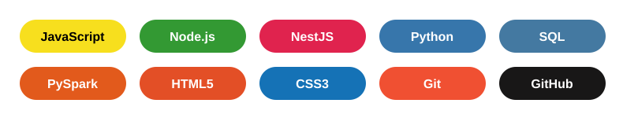

## Sobre mí
Soy desarrollador en formación con enfoque en calidad de software. Construyo aplicaciones web y APIs con JavaScript, Node.js y NestJS, y automatizo pruebas y validación de datos con Python.
Me apasiona escribir código limpio, probar lo que construyo, el análisis de datos y el manejo de SQL, y seguir aprendiendo cada día.

## Stack

  

## Proyectos destacados
- **[riwi-qa-spark](https://github.com/tuusuario/riwi-qa-spark)**: pipeline de validación de transacciones con PySpark.

## Contacto

  
  

